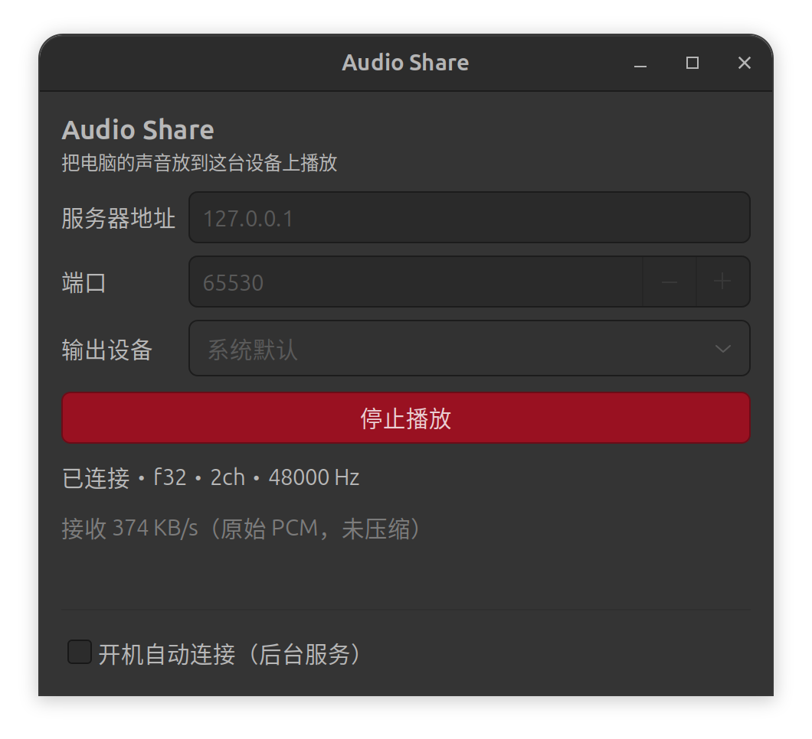

# Linux client for Audio Share

Upstream Audio Share ships a server (`as-cmd`, Windows + Linux with PipeWire)
and an **Android** client. This directory adds the missing half: a small C
client that receives the PCM stream on **any Linux box with PipeWire** —
x86-64 desktop, Raspberry Pi, an ARM tablet running a mainline-kernel distro,
a headless box plugged into a Hi-Fi DAC, … No GUI, no runtime dependencies
besides `pw-cat` (`pipewire-bin`).

```
PC (Windows/Linux)                       this client
┌──────────────────┐   TCP 65530  ┌──────────────────────────┐
│ as-cmd           │◀────────────▶│ as-client <host> [port]  │
│ PipeWire capture │   UDP  PCM   │  └─▶ pw-cat --playback … │
└──────────────────┘◀─────────────┴──────────────────────────┘
```

## Quick start: install the .deb (GUI + icon, click to run)

```sh
./deb/build-deb.sh                 # → ../dist/audio-share-client_<ver>_arm64.deb
sudo dpkg -i ../dist/audio-share-client_0.1.0_arm64.deb
```

Then open **Audio Share** from the app grid (or `audio-share-gui` from a
terminal): type the server address, pick an output sink if you do not want the
default one, press **开始播放**. The window shows the negotiated format
(`f32 · 2ch · 48000 Hz`) and the live throughput, and the *开机自动连接* checkbox
enables the bundled `systemd --user` unit so it plays right after boot.



The package installs:

| path | what |
|---|---|
| `/usr/bin/as-client` | the C client, statically linked (musl), no runtime libs |
| `/usr/bin/audio-share-gui` | GTK3 window (python3-gi), spawns `as-client -v` and mirrors its log |
| `/usr/bin/audio-share-client-run` | wrapper reading `~/.config/audio-share-client/config.json` |
| `/usr/share/applications/audio-share-client.desktop` | app-grid entry |
| `/usr/share/icons/hicolor/scalable/apps/audio-share-client.svg` | icon |
| `/usr/lib/systemd/user/audio-share-client.service` | auto connect at login |

Depends: `python3-gi`, `gir1.2-gtk-3.0`, `pipewire-bin` (GTK3 rather than GTK4
on purpose — that is what Phosh-era ARM distros ship). Other architectures:
`ARCH=amd64 ./deb/build-deb.sh` (needs a native compiler, `CC=cc`).

The GUI never talks to the server itself: it runs the same `as-client` binary,
so a hand-started window and the boot service behave identically. Starting the
window while the background service is already playing shows
*后台服务正在播放* instead of opening a second peer (two peers would play twice).

## Build

```sh
cd linux-client
make                       # native
make CROSS=aarch64-linux-musl-   # ARM64 with a musl cross toolchain
make CROSS=arm-linux-gnueabihf-  # ARM32 hf
make install               # installs to /usr/local/bin
```

`as-client` is plain C11 (a hand-written reader for the three-field protobuf
`AudioFormat` keeps it dependency free), so a static musl build drops into any
rootfs without shipping glibc.

## Run without the GUI

```sh
as-client 192.168.1.10              # server on the default port 65530
as-client 192.168.1.10 65530 -v     # log PCM throughput
as-client 192.168.1.10 --target alsa_output.usb-DAC.analog-stereo
as-client 192.168.1.10 --latency 60 # lower latency (default: pw-cat default)
```

It reconnects every 3 s until the server shows up and after any link loss, so
it is safe to start from a boot unit.

As a user service (PipeWire must run in the same session):

```sh
mkdir -p ~/.config/systemd/user
cp audio-share-client.service ~/.config/systemd/user/
$EDITOR ~/.config/systemd/user/audio-share-client.service   # set server address
systemctl --user daemon-reload
systemctl --user enable --now audio-share-client.service
journalctl --user -u audio-share-client -f
```

## Protocol (why the code looks like that)

Byte-exact reference: `docs/protocol.md` plus the Android sources
`android-app/.../service/{NetClient,NetworkIO}.kt`. All integers are little
endian `int32`.

| step | direction | payload |
|---|---|---|
| 1 | client → server | `1` (CMD_GET_FORMAT) |
| 1 | server → client | `1`, `size`, `size` bytes protobuf `AudioFormat` |
| 2 | client → server | `2` (CMD_START_PLAY) |
| 2 | server → client | `2`, `id` (`id > 0`) |
| 3 | client → server | UDP datagram containing `id` (announces the ephemeral port) |
| 3 | server → client | raw PCM datagrams, format from step 1 |
| 4 | server → client | `3` (CMD_HEARTBEAT) every 3 s |
| 4 | client → server | `3` echoed; the server drops a peer silent for 5 s |

`AudioFormat` is `{encoding=1, channels=2, sample_rate=3}`, all varints;
encodings are `1=f32 2=u8 3=s16 4=s24 5=s32`. On Linux the server forces
`f32` (`SPA_AUDIO_FORMAT_F32_LE`) because Android's `AudioTrack` cannot play
planar formats, and leaves channels/sample rate as PipeWire decides.

Bandwidth is raw PCM: `f32 / 2 ch / 48 kHz` ≈ 384 KB/s ≈ 3 Mbit/s. Wired
Ethernet or USB-NCM tethering is comfortable; congested Wi-Fi will drop
datagrams (audible as gaps).

## Tests

```sh
make                      # native build used by the smoke test
xvfb-run -a python3 test/gui-smoke.py
```

The smoke test builds the window headlessly against a locally running `as-cmd`,
starts playback, waits for the throughput counter, saves a screenshot
(`/tmp/audio-share-gui.png`) and exits non-zero unless the stream is live.
(Set `AS_HOST`/`AS_PORT` if the server is not on `127.0.0.1:65530`.)

## Troubleshooting

| symptom | cause |
|---|---|
| `bad AudioFormat size 0` in a loop | the server has no audio endpoint: its log says `audio endpoint list is empty` (no sound card, or PipeWire without a sink). Check `as-cmd -l` on the PC; restart `as-cmd` after plugging the endpoint in. |
| connects, plays nothing | `pw-cat` missing (`pipewire-bin`) or a different `PIPEWIRE_REMOTE` than the session's PipeWire. Try `pw-cat --playback --raw -` manually. |
| audio plays on the PC's speakers instead of this box | target the sink explicitly with `--target` (`wpctl status` lists sinks). |
| drops every ~3 s | heartbeat never arrives → TCP path broken/NAT; check the port is not blocking TCP+UDP. |
| window says 后台服务正在播放 | the boot unit is active (that is why there is sound); press 停止后台播放 to take over manually. |

## Notes

* `pw-cat` is respawned per session, so a server restart or a PipeWire restart
  is handled without touching the unit.
* The playback pipe is non-blocking: if the sink stalls, PCM is dropped instead
  of blocking the receive loop — otherwise a stalled player would starve the
  TCP heartbeat and the server would kick the session every few seconds.
* Volume is multiplicative across: PC system volume × player volume × this
  box's PipeWire sink volume. The client does no volume processing (resolution
  is unaffected; raw PCM is forwarded bit-exactly).
* Apache-2.0, same as upstream.
